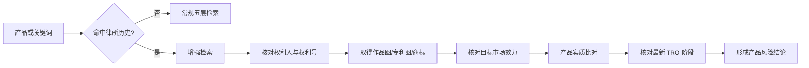

# TRO 律所情报使用规则

## 核心判断

## 联动等级

| 命中情况 | 处理 | 能否单独改变产品结论 |
|---|---|:---:|
| 只命中律所名称 | 增加律所名、律师名和近 12 个月案件检索 | ❌ |
| 命中律所 + 权利人 | 检索该权利人的全部相关案件与权利清单 | ❌ |
| 命中律所 + 具体权利号 | 强制取得官方权利状态和案件文件 | ⚠️ 仍需产品比对 |
| 命中有效权利 + 产品实质相似 + TRO 已获批 | 至少上调一级，不得 Go | ✅ |
| 用户已收到冻结/传票 | 立即保存通知、案号、店铺和资金证据，转专业律师处理 | ✅ 实操高风险 |

## 产品审查页新增记录

每次命中律所历史时，产品页至少记录：

- `matched_law_firms`
- `matched_rights`
- `matched_cases`
- `law_firm_match_basis`
- `tro_stage`
- `stage_evidence`
- `last_checked_at`

## 禁止事项

- 不得因为“Keith/GBC/HSPRD/JiangIP 代理过类似产品”直接判侵权。
- 不得用律所网站、商业追踪页或中文预警代替法院 TRO 命令。
- 不得把同一案件中的共同代理重复统计为两宗案件。
- 不得把历史 TRO 写成当前仍在执行；必须记录日期和最新阶段。

