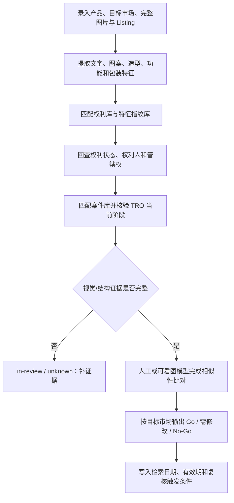

# Keith 与 TRO 风险情报库建设方案

> [!important] 建设原则
> 不建设“看到 Keith 就判侵权”的黑名单。应建设可追溯的 **权利—案件—执行状态—产品特征—证据** 关联库。Keith 或其他律所仅是执行强度信号，不能替代对权利有效性、管辖权和实质性相似的判断。

> [!success] MVP 已落地
> 已建立 [[wiki/dashboards/Keith-TRO情报看板]]、[[wiki/entities/litigation-cases/_template|案件模板]]、[[wiki/entities/ip-rights/_template|权利模板]] 和 [[wiki/entities/law-firms/Keith-Vogt-Ltd|Keith 律所实体页]]。首批录入 Anagram 已核验 TRO 案和 Vorotnikov 误配纠错案。

> [!success] 多律所扩展已落地
> 已新增 [[wiki/dashboards/TRO律所情报库]]，首批覆盖 Keith Vogt、Greer Burns & Crain、HSPRD 和 JiangIP，并建立“已核验最低案件数”口径与产品审查联动规则。

## 一、库要回答的五个问题

1. 这个产品的图案、文字、造型、功能或 Listing 素材，可能对应哪一项知识产权？
2. 该权利是否覆盖本次销售、进口或履约市场？
3. 权利是否有效，权利人和授权链是否明确？
4. 是否已进入诉讼或 TRO 流程，当前准确阶段是什么？
5. 现有视觉、文字和结构证据是否足以作出 Go / 需修改 / No-Go？

## 二、推荐的数据模型

### 1. 权利库 `rights`

一项版权、商标、设计专利或发明专利一条记录。

| 字段 | 说明 |
|------|------|
| `right_id` | 内部唯一编号 |
| `right_type` | copyright / trademark / design-patent / utility-patent |
| `registration_no` | VA、商标号、专利号等 |
| `title_or_mark` | 作品名、商标名或专利标题 |
| `owner` | 登记权利人 |
| `jurisdictions` | 实际覆盖国家/地区 |
| `filed_at` / `registered_at` | 申请与登记日期 |
| `right_status` | pending / active / expired / cancelled / unknown |
| `specimen_assets` | 官方样本、专利附图、商标图样 |
| `status_checked_at` | 最近一次官方状态核验时间 |
| `source_tier` | official / court / secondary / community-lead |

### 2. 案件库 `cases`

一宗法院案件一条记录，不把一篇预警文章当成一个案件。

| 字段 | 说明 |
|------|------|
| `case_id` | 案号，含法院信息 |
| `court` | 法院 |
| `plaintiff` | 原告 |
| `law_firm` | Keith 或其他代理律所 |
| `asserted_rights` | 关联 `right_id` |
| `filed_at` | 立案日期 |
| `tro_stage` | none / complaint / motion-filed / granted / active / expired / vacated / dismissed / unknown |
| `stage_evidence` | 支撑当前阶段的法院文件 |
| `schedule_a_status` | public / sealed / partially-public / unknown |
| `last_checked_at` | 最近核验时间 |
| `next_check_at` | 下次复核时间 |

> [!warning] TRO 状态门禁
> `motion-filed` 不等于 `granted`，`granted` 也不等于当前仍 `active`。没有法院文件支撑时只能标为 `unknown`。

### 3. 作品与特征指纹库 `work-fingerprints`

用于把商品视觉元素和已知权利关联起来。

| 字段 | 说明 |
|------|------|
| `fingerprint_id` | 特征记录编号 |
| `right_id` | 关联权利 |
| `keywords_zh` / `keywords_en` | 中英文关键词及同义词 |
| `visible_text` | 图案中的文字、标语和拼写变体 |
| `motifs` | 蜜蜂、花环、房屋轮廓等视觉母题 |
| `layout_features` | 构图、字体组合、线条、色彩和元素相对位置 |
| `image_assets` | 官方作品图、诉讼附件、可靠对比图 |
| `image_hash` | 精确重复检测用 SHA-256 / pHash |
| `visual_evidence_status` | missing / metadata-only / described / human-verified / vision-verified |

图片哈希只能发现完全相同或近似文件，不能替代“实质性相似”判断。最终对比必须保留逐项视觉分析和核验人。

### 4. 主体库 `parties`

统一记录权利人、原告、设计者、代理律所及其别名，避免同一主体因中英文、公司后缀或拼写差异被拆成多条。

关键字段：`party_id`、标准名称、别名、主体类型、关联权利、关联案件、已核验来源。

### 5. 产品审查库 `product-reviews`

继续使用 [[wiki/products/_template|产品审查模板]]，新增与情报库的关联字段：

- `matched_right_ids`
- `matched_case_ids`
- `match_reason`
- `similarity_status`
- `evidence_complete`
- `searched_at`
- `valid_until`
- `review_trigger`：new-product / listing-change / packaging-change / alert-hit / scheduled-recheck

### 6. 证据账本 `evidence`

所有重要结论都指向证据，而不是只写搜索结论。

| 证据等级 | 示例 | 用法 |
|:--------:|------|------|
| A | 法院 docket/命令、官方登记库、官方专利全文 | 可支撑权利与程序状态 |
| B | 当事人正式文件、可靠诉讼数据库 | 交叉验证 |
| C | 跨境电商预警文章、worldtro、论坛 | 只作线索，必须回查 A/B |
| D | 供应商口头承诺、卖家数量、搜索无结果 | 不得作为低风险结论依据 |

## 三、产品审查时的检索流程

### 必须同时检索的入口

- 产品关键词、图案文字、拼写变体和中英文同义词
- 版权号、专利号、商标号
- 权利人、原告和代理律所
- 案号和法院
- `关键词 + copyright/TRO/lawsuit/Keith`
- `关键词 + VA + copyright registration`
- 具体权利号 + `TRO/injunction/lawsuit`

## 四、风险规则

1. **Keith 命中是执行风险增强项，不是侵权成立证明。**
2. 发现由 Keith 代理且已进入执行阶段的权利，风险至少上调一级；图案或文字设计实质性相似时按高风险处理。
3. 通用短语、简单图形或公共领域元素仍要检查其具体艺术化表达是否已登记并被执行。
4. 未找到案件、Schedule A 被密封或数据库暂不可访问时，结论是“未确认/待复核”，不是“安全”。
5. 非目标市场的专利、商标或设计不得用于阻断该市场；版权和指定目标市场的国际申请按跨境规则处理。
6. 所有案件状态必须记录 `last_checked_at`；商品图、包装、文案、品牌或供应商发生变化时触发增量复审。

## 五、预警看板

建议建立 Dataview 看板，至少展示：

- 最近 30 天新增案件
- `tro_stage` 从 `motion-filed` 变为 `granted/active` 的案件
- 30 天内需复核但尚未复核的记录
- 同一权利关联多个案件的高频执行权利
- 已命中产品但视觉证据仍为 `missing/metadata-only/described` 的审查
- 曾判 `cleared`、后来出现新案件或新权利信号的产品

## 六、最小可运行版本

### 第一阶段：先能用

- 建立 `rights`、`cases`、`parties` 三类页面模板。
- 把现有 [[189-蜜蜂气球]]、[[223-钥匙挂钩]] 拆成权利记录和案件记录。
- 为每条记录补齐官方来源、案件阶段、核验日期和下一次复核日期。
- 建一个“Keith/TRO 命中”Dataview 看板。

### 第二阶段：减少漏判

- 加入图案文字、同义词、主体别名和视觉特征指纹。
- 新产品录入时自动检索已有权利、案件和关键词。
- 对图片使用 SHA-256/pHash 做重复线索匹配，但保留人工/视觉模型核验门禁。

### 第三阶段：持续更新

- 周期性只读复核案件 docket、权利状态和跨境预警线索。
- 只有状态变化时通知；每次通知附证据链接和变化前后状态。
- 对所有 `cleared` 结论设置有效期，过期后自动回到待复核。

## 七、不要这样做

- 不要仅以“Keith 代理”直接判 No-Go。
- 不要把投诉、TRO 动议、TRO 批准和正在执行混成一个 `TRO = yes`。
- 不要只存文章截图，不存案号、权利号和官方证据。
- 不要用“卖家多”“供应商说是公模”“搜索没结果”证明不侵权。
- 不要让图片存在于 Obsidian 就假设 AI 已经看懂图片。
- 不要永久保存“低风险”而不记录检索截止日和有效期。

## 关联页面

- [[wiki/synthesis/版权排查经验教训-Keith蜜蜂案|版权排查经验教训 — Keith TRO 案合集]]
- [[wiki/synthesis/审查框架缺口审计与视觉证据方案|审查框架缺口审计与视觉证据方案]]
- [[wiki/concepts/TRO临时禁令|TRO 临时禁令]]
- [[wiki/products/_template|产品审查模板]]
- [[wiki/sources/2026-06-03-专利与侵权风险排查SOP|专利与侵权风险排查 SOP]]
