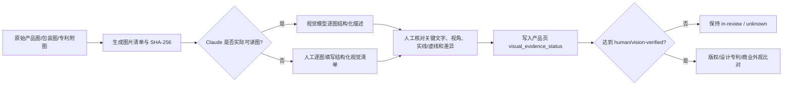

# 审查框架缺口审计与视觉证据方案

> [!danger] 核心结论
> 现有框架最大的风险不是“少搜一个网站”，而是**证据不足时仍然收敛到低风险/Go**。本地 Claude 看不到 Obsidian 图片时，PIL 的颜色、深色像素和纹理统计不能证明无文字、无图案或与专利附图不近似。所有依赖视觉判断的结论必须设置硬门禁。

## 一、这次发现的主要遗漏

| # | 遗漏 | 可能造成的假阴性 | 新控制 |
|:-:|------|------------------|--------|
| 1 | Obsidian 可显示图片被误当成 Claude 已看图 | 对文字、Logo、角色、实线/虚线、整体视觉效果作无依据判断 | `visual_evidence_status` + 逐图证据清单；未验证不得 Go |
| 2 | PIL 像素统计被当成视觉识别 | 深色像素少不等于无文字，纹理低不等于无浮雕/装饰 | PIL/OCR 降级为元数据和检索线索 |
| 3 | 只按销售站点决定全部管辖范围 | 漏掉制造、进口清关、FBA/海外仓和实际配送地的风险 | 生成 `review_markets`，同时披露未审连接点 |
| 4 | 版权层只在“印刷图案”时触发 | 漏掉雕塑、浮雕、首饰、包装、标签、Listing 图片、视频、文案、字体和供应商素材 | 扩大版权触发面并核验素材权属链 |
| 5 | 商标只查注册库和完全相同文字 | 漏掉普通法/未注册商标、图形商标、发音/翻译近似和商业外观 | 注册库 + 实际使用 + Design Code + 近似检索 |
| 6 | “核心关键词被注册且同类”直接等同侵权 | 忽略描述性使用、标识性使用和混淆可能性 | 改为基于使用方式和混淆风险判断 |
| 7 | 检索不到倾向于低风险 | 数据库不可访问、检索式过窄、OCR/索引延迟均会产生空结果 | 检索证据账本；失败/缺证据=`unknown` |
| 8 | 候选权利只看标题、摘要或同品类 | 漏掉当前权利人、失效、指定国、家族、独立权利要求变化和设计附图限定 | 强制权利状态与保护范围核验 |
| 9 | “公模、卖家多、市场常见”被当成安全证据 | 市场上可能存在集体侵权或尚未执行 | 市场数据只证明商业普遍性，不证明合法性 |
| 10 | TRO 只有“有/无”二元状态 | 把 complaint、申请 TRO、已批准、已失效/撤销混为一谈 | 记录案件阶段、命令日期、范围和当前状态 |
| 11 | 未区分产品版本和素材版本 | 改颜色、Logo、结构、包装或供应商后仍沿用旧结论 | SKU/版本冻结 + 变更触发增量复审 |
| 12 | 报告无统一时效 | 上架前已出现新申请、授权、诉讼或 TRO | `searched_at` + `valid_until`；登记簿默认30天、TRO动态7天 |
| 13 | 美国进口风险只看法院 TRO | 漏掉 USITC Section 337 排除令和 CBP 边境执法 | 美国进口审查加入 USITC/CBP 检查 |
| 14 | “Go”表述过强 | 团队把筛查报告误当法律意见或绝对安全保证 | Go 改为限定范围、证据和截止日的消极保证 |

## 二、本地 Claude 看不到图片时的可执行方案

### 最低图片包

1. 产品正面、背面、左右侧、顶部、底部。
2. 功能结构、连接关系、内部/拆解和尺寸图。
3. 所有文字、Logo、图案、浮雕、纹理和装饰特写。
4. 包装、标签、说明书、Listing 主图、A+页面与视频关键帧。
5. 每件候选设计专利的全部相关附图页，并标注实线与虚线。

### 结构化视觉清单必须回答

- 这是什么视角，是否有遮挡或裁切？
- 可见文字/OCR 是什么，人工是否确认？
- 整体轮廓、比例、部件数量与相对位置是什么？
- 独特装饰、表面纹理、配色、角色或艺术表达是什么？
- 与候选权利共同点、差异点分别是什么？
- 哪些判断来自原图，哪些来自描述或推断？

> [!warning] 不可接受的替代
> “主色是粉色”“深色像素0.1%”“表面对比度低”“图片已嵌入 Obsidian”“供应商说是公模”都不能单独支持视觉低风险结论。

## 三、证据与决策模型

### 完成状态

| 状态 | 含义 | 能否最终 Go |
|------|------|:-----------:|
| `missing` | 无图或模型/人工均无法读取 | ❌ |
| `metadata-only` | 仅尺寸、颜色、OCR、PIL | ❌ |
| `described` | 有描述但未逐图核验 | ❌ |
| `human-verified` | 人工逐图签核 | ✅ 可进入最终判断 |
| `vision-verified` | 视觉模型读取原图且有哈希/模型/日期记录 | ✅，关键近似仍建议人工复核 |

### 风险与完整性分开

- `risk_level` 回答“已知证据显示多大风险”。
- `status/in-review` 回答“审查是否完成”。
- 证据不足不是“中风险”，而是 `unknown`；不得为了给业务一个答案而强行降级成 🟡 或 🟢。

## 四、历史审查的回溯建议

优先重开所有曾以 PIL 或未签核目视结论支持 Go 的记录：

1. **优先级 A**：[[wiki/products/820-乳腺癌胸针-合金款]]、[[wiki/products/824-乳腺癌丝带胸针]]、[[wiki/products/818-乳腺癌手链]]、[[wiki/products/847-带绶带的舞会皇冠]]。这些页面含设计/版权视觉结论且当前为 `cleared`。
2. **优先级 B**：[[wiki/products/288-鞋子清洗袋]]、[[wiki/products/118-咖啡杯整理器]]、[[wiki/products/223-钥匙挂钩]]。本来已是 risky，但应补全视觉证据以决定修改方向。
3. **优先级 C**：其余使用“深色像素=无文字/Logo”或“建议目视确认后仍 Go”的页面，批量改为待视觉复核。

本次只更新工作流和模板，**未自动篡改历史产品结论**；回溯应作为单独批次执行并保留原结论与修订记录。

## 五、官方依据与工具校正

- USPTO 的 TESS 已于 2023-11-30 退役，现行系统为 [Trademark Search](https://www.uspto.gov/subscription-center/2023/retiring-tess-what-know-about-new-trademark-search-system)。
- USPTO 明确说明联邦商标数据库不包含所有普通法权利，需补充实际使用调查：[Why register your trademark?](https://www.uspto.gov/trademarks/basics/why-register-your-trademark)。
- 美国版权局说明视觉艺术可包括照片、首饰、雕塑及应用于商品的艺术作品，版权保护不以登记为起点：[Visual and Graphic Artists](https://www.copyright.gov/engage/visual-artists/)；有用物品上的可分离艺术表达也可能受保护：[Useful Articles](https://copyright.gov/register/va-useful.html)。
- USPTO 当前专利官方检索工具是 [Patent Public Search](https://www.uspto.gov/patents/search/patent-public-search)，官方检索策略要求深入阅读附图、说明书和权利要求。
- 美国进口还可能受 USITC Section 337 排除令影响：[About Section 337](https://www.usitc.gov/about_section_337.htm)；商标和版权可通过 CBP recordation 获得边境执法：[CBP IPR FAQ](https://www.help.cbp.gov/s/article/Article1857?language=en_US)。

## 六、已同步的工作流文件

- [[CLAUDE.md]]：新增视觉证据硬门禁、证据账本、时效、交易链连接点、普通法商标、素材权属链和 TRO 阶段核验。
- [[wiki/products/_template]]：新增视觉状态、图片哈希清单、完整性门禁、证据账本和供应商授权链字段。
- [[wiki/synthesis/审核流程中需手动补充事项清单]]：更新本地 Claude 无图时的人工/视觉模型分工。

